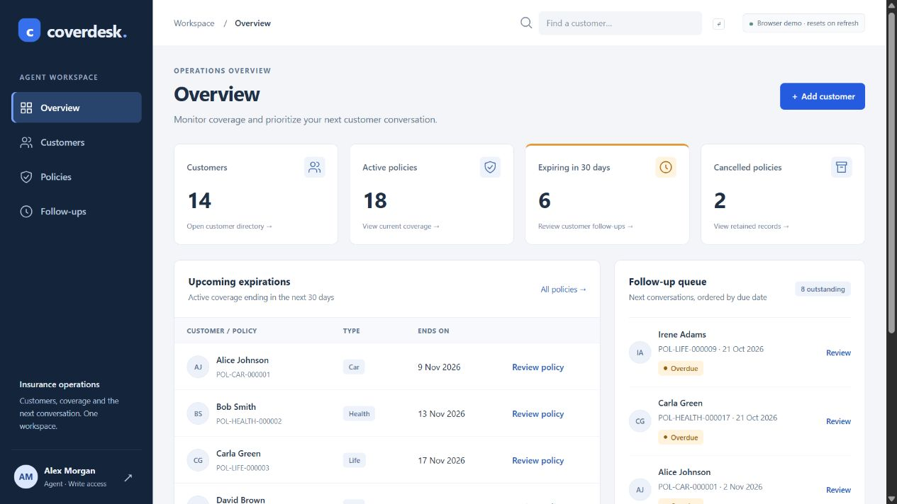

# Insurance Management System - Backend API

## Current status · 7 November 2026

Backend API source is on the repository default branch, `feature/api-hardening-and-tests`. No directly linked Vercel deployment of this API was verified. The related [Coverdesk browser demo](https://coverdesk.vercel.app/) is READY on Vercel and was opened successfully with fictional data. It resets on refresh and is not evidence of a running .NET API; its frontend source is not present on this branch. [Coverdesk on Vercel](https://vercel.com/sofia-muses-projects/coverdesk).



Captures from 7 November 2026; existing portfolio captures are explicitly labeled above.

Backend service (API) for insurance agents to manage policyholders and policy lifecycle with auditability and reliable business rules.

## Quick System Summary

- **Purpose:** Manage customers and policies with predictable contracts for issue, update, list, and cancel flows.
- **Business safety:** Enforces core invariants (for example, one active Car policy per customer) at service and database levels.
- **Operational reliability:** Supports idempotent writes, correlation IDs, structured errors, and request logging.
- **Auditability:** Every policy state change is captured as a policy event with a state snapshot.

## Tech Stack

- ASP.NET Core 8 Web API
- EF Core 8 with SQL Server LocalDB
- FluentValidation
- Swagger / OpenAPI
- xUnit + FluentAssertions

## Prerequisites

- .NET 8 SDK
- SQL Server LocalDB (bundled with Visual Studio / SQL Server Express)

## Setup and Run

```bash
git clone https://github.com/sofia-muse/insurance-management-system.git
cd insurance-management-system
git checkout feature/api-hardening-and-tests
dotnet restore
dotnet run --project InsuranceManagement.Api --launch-profile http
```

Swagger:
- http://localhost:5275/swagger

Startup behavior is configuration-driven:
- In `Development`, migrations and seed data run by default.
- In non-development environments, both are disabled by default.
- Override via:
  - `Database:RunMigrationsOnStartup` (`true`/`false`)
  - `Database:RunSeedOnStartup` (`true`/`false`)

Write-endpoint protection is JWT policy based:
- Configure `Jwt:Issuer`, `Jwt:Audience`, and `Jwt:SigningKey`.
- Mutating endpoints (`POST`/`PUT`/`PATCH`/`DELETE`) require a valid bearer token with `scope=api.write` or role `writer`.
- Missing token returns `401 AUTH_REQUIRED`; insufficient claims returns `403 AUTH_FORBIDDEN`.
- Optional legacy API-key fallback exists only when `ApiSecurity:EnableLegacyWriteApiKey=true`.

### Migrations

Create a new migration:

```bash
dotnet ef migrations add <MigrationName> --project InsuranceManagement.Infrastructure --startup-project InsuranceManagement.Api
```

Apply migrations manually:

```bash
dotnet ef database update --project InsuranceManagement.Infrastructure --startup-project InsuranceManagement.Api
```

## Run Tests

```bash
dotnet test
```

Most tests run on EF InMemory. Relational invariant tests require SQL Server LocalDB.

## Architecture

- `InsuranceManagement.Api`: controllers, DTOs, validators, middleware
- `InsuranceManagement.Core`: entities, enums, interfaces, domain exceptions
- `InsuranceManagement.Infrastructure`: DbContext, services, seed
- `InsuranceManagement.Tests`: unit and integration tests

## Data Model

- Customer 1:N Policy
- Policy types: `Car`, `Health`, `Life`
- Policy statuses: `Active`, `Cancelled`, `Expired`
- Policy events: `Issued`, `Updated`, `Cancelled`

## Key Production-Polish Features

- Policy audit trail via `PolicyEvents`
- Idempotent issue/cancel via `Idempotency-Key` header
- Paginated and sortable list endpoints
- Correlation IDs (`X-Correlation-Id`) and structured request logging
- Stable machine-readable error codes
- App-level rate limiting with deterministic `429 RATE_LIMIT_EXCEEDED`

## API Endpoints

### Customers

- `POST /api/customers`
- `GET /api/customers?search=&page=&pageSize=&sortBy=&sortDir=`
- `GET /api/customers/{id}`
- `PUT /api/customers/{id}`

### Policies

- `POST /api/customers/{customerId}/policies` (supports `Idempotency-Key`)
- `GET /api/policies?type=&status=&customerId=&page=&pageSize=&sortBy=&sortDir=`
- `GET /api/policies/{id}`
- `GET /api/policies/{id}/events`
- `PUT /api/policies/{id}`
- `POST /api/policies/{id}/cancel` (supports `Idempotency-Key`)

## Response Contracts

### Pagination envelope

```json
{
  "items": [],
  "page": 1,
  "pageSize": 20,
  "totalItems": 0,
  "totalPages": 0
}
```

### Error payload

```json
{
  "title": "Business Rule Violation",
  "status": 400,
  "code": "POLICY_CANCELLED_UPDATE_FORBIDDEN",
  "detail": "Cancelled policies cannot be updated.",
  "traceId": "...",
  "errors": {
    "FieldName": ["Validation message"]
  }
}
```

### Policy events payload

`GET /api/policies/{id}/events` returns audit metadata and a safe `note` field when available. Raw internal snapshot JSON is not exposed.

## Idempotency

For issuance/cancel endpoints:
- Send `Idempotency-Key` header.
- Reusing same key + same payload returns prior result.
- Reusing same key + different payload returns `409` with code `IDEMPOTENCY_KEY_REUSED_WITH_DIFFERENT_PAYLOAD`.

## Correlation ID

- Request header: `X-Correlation-Id` (optional)
- If absent or invalid, API generates one (max 64 chars, alphanumeric + `-` `_` `.`).
- Returned on every response and used in logs/error payload.

## Validation Highlights

- Customer must be 18+ and DOB in the past
- Premium range: 1 to 1,000,000
- End date must be on or after start date
- Policy term upper bound validation (sanity check)

## Business Assumptions

1. Policies can only be issued to existing customers.
2. Customer email is unique.
3. One active Car policy per customer.
4. Cancel is soft-terminate; records are retained.
5. Expired is derived from `EndDate`.

## Production Notes

- `ExceptionHandlingMiddleware` is registered first so standardized error envelopes apply across the pipeline.
- Policy writes use optimistic concurrency protection and may return `409` with code `POLICY_CONCURRENT_MODIFICATION` when stale updates are detected.
- Database enforces one active `Car` policy per customer (`UX_Policy_OneActiveCarPerCustomer`).

## Smoke Test Checklist

Run the API and validate core contracts quickly:

1. `POST /api/customers` twice with same email (case-insensitive) -> second returns `409 CUSTOMER_EMAIL_EXISTS`.
2. Issue same policy request twice with same `Idempotency-Key` -> second returns same resource.
3. Reuse same `Idempotency-Key` with changed payload -> `409 IDEMPOTENCY_KEY_REUSED_WITH_DIFFERENT_PAYLOAD`.
4. Cancel policy, then try `PUT /api/policies/{id}` -> `400 POLICY_CANCELLED_UPDATE_FORBIDDEN`.
5. Send invalid `X-Correlation-Id` header -> response returns a generated sanitized correlation ID.
6. Call `POST /api/customers` without bearer token -> `401 AUTH_REQUIRED`.
7. Send >20 write requests/minute from the same identity -> `429 RATE_LIMIT_EXCEEDED`.

## Seeded IDs

- Alice Johnson: `11111111-1111-1111-1111-111111111111`
- Bob Smith: `22222222-2222-2222-2222-222222222222`
- Sample Car policy: `33333333-3333-3333-3333-333333333333`
